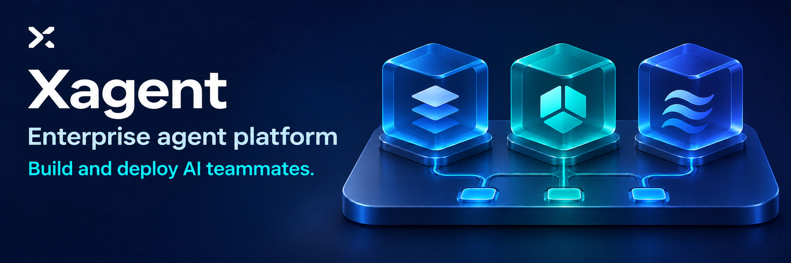
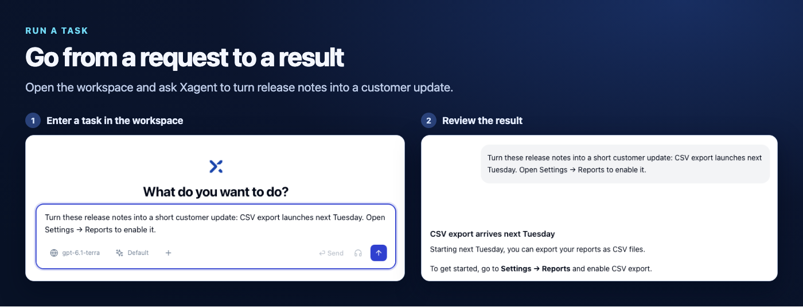
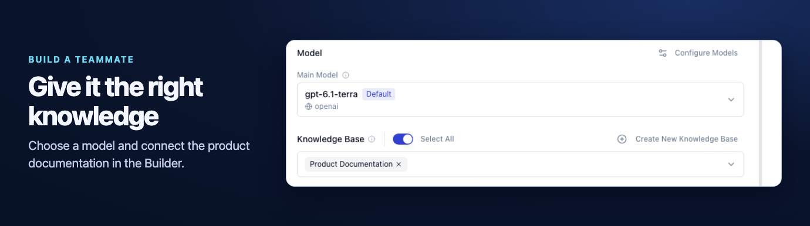
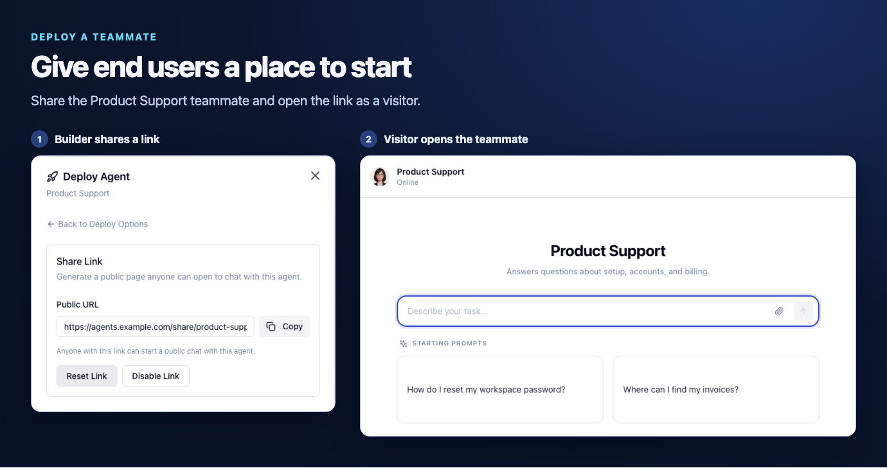
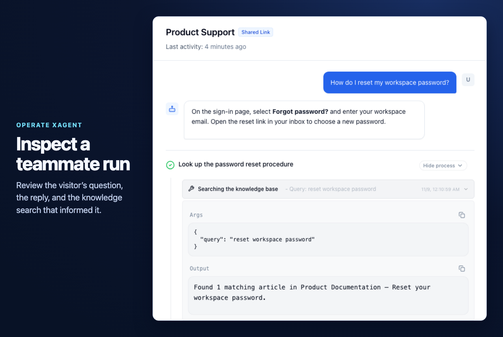

# Xagent

**The enterprise platform for building and deploying AI teammates.**

Open Xagent, describe a task in the workspace, and run it right away. For repeatable work, start from a teammate template or build your own. Publish the teammate when you want other people to use it.

[Get started](#quick-start) · [Run a task](#run-a-task) · [Build a teammate](#build-a-teammate) · [Documentation](https://docs.xagent.co/)

## Why choose Xagent?

Once an agent starts serving other people, your organization needs to decide what it can access, where users can reach it, and how to investigate a bad result. Xagent gives you a workspace for getting work done and a way to publish and operate the teammates that take on recurring responsibilities.

- **Start with a real request.** Run a task directly from the workspace. In Auto mode, Xagent can answer directly, call tools, or plan and execute multiple steps based on the request.
- **Reuse the same specialist.** Use a published teammate directly from the workspace, or add it to a Workforce where a manager can delegate work to it. Configure the specialist's model, skills, tools, and knowledge in one place.
- **Follow the request after launch.** Let users reach a teammate through a link, a widget, or your own app. Find conversations by teammate and source, then inspect the transcript and any recorded tool calls for a particular request.

## What is Xagent?

Xagent is a self-hostable platform for **AI teammates**. A teammate is a reusable agent configured for a specific job, with its own instructions, model, skills, tools, and knowledge.

Use a teammate directly in Xagent, or publish it for end users through a shareable link, an embedded widget, or an application connected via API.

## How does Xagent work?

1. **Configure and test.** Select the models and resources a teammate needs, connect your tools and knowledge, and test a sample request in the Builder.
2. **Publish and deliver.** Choose where people will use the teammate. Enable a share link, embed it on an allowed domain, or call it from your application with an agent API key.
3. **Run and inspect.** Deploy Xagent on your infrastructure and use conversation logs and monitoring to see how teammates handle requests.

## Run a task

Enter a request in the workspace and send it. In this example, Xagent turns a few release notes into a customer update in the same conversation.



## Build a teammate

Open **Add a teammate** to start from a template or create your own. In the Builder, describe the job, choose a model, and attach the skills, tools, and knowledge the job calls for.

For a **Product Support** teammate, connect the product documentation and set instructions for answering setup, account, and billing questions. Try a question in **Preview** before publishing.



Skills package reusable instructions and resources. Knowledge bases supply reference material. MCP connectors bring external tools and systems into the teammate's workflow.

## Deploy for end users

Publish the teammate, then choose an entry point that fits where your users already work.

| Entry point | How people use it |
| --- | --- |
| **Shareable link** | Visitors open a hosted chat page for the published teammate. Enable, reset, or disable the link from its deployment settings. |
| **Embedded widget** | Add chat to a site such as a help center and configure the allowed domains. |
| **REST API** | Call the teammate from your application or backend using an agent API key. |



Teammates can also run on a schedule or respond to webhook events. For jobs that require several specialists, create a Workforce with a manager agent and published teammates.

## Operate Xagent

Use **Conversation Logs** to find a conversation by teammate or entry point. Open a run to review its transcript and execution steps, including tool calls when trace data is available. In the Product Support example, you can see the visitor's question, the reply, and the knowledge search behind it.



- **Infrastructure.** Self-host Xagent with Docker Compose and manage user accounts on your deployment.
- **Models.** Connect supported API providers or serve your own models through Xinference.
- **Execution.** Enable sandboxing for eligible tool calls and use monitoring to track model and tool usage.

See the [deployment guide](docker/README.md), [release-specific deployment notes](docs/deployment.md), and [sandbox guide](docker/README.sandbox.md).

## Quick start

### Evaluate locally

The Python package includes the web UI. Use Python 3.11 or later.

```bash
uv tool install xagent-ai
xagent
```

1. Open [localhost:8000](http://127.0.0.1:8000) and create the first administrator account at `/setup`.
2. Connect a model provider on the **Models** page. To try Xagent right away, open **New task** and describe the work you want to run.
3. Choose **Add a teammate**, then create or select a teammate and test it in the Builder.
4. Publish the teammate, enable its share link, and open the link in a private browser window to try the visitor experience.

Moving from OpenClaw or Hermes? Use `xagent migrate` to import agent configuration, skills, and supported schedules. Run `xagent migrate --dry-run` to preview the import.

### Run with Docker Compose

```bash
git clone https://github.com/xorbitsai/xagent.git
cd xagent
cp example.env .env
docker compose up -d
```

Open [localhost](http://localhost/) and complete setup. Review the deployment settings in `.env` before running on a shared host. For production, serve Xagent over HTTPS and follow the [deployment guide](docker/README.md).

Forgot the administrator password? See [how to reset it from the Docker host](docker/README.md#reset-the-administrator-password).

## Documentation and community

[Documentation](https://docs.xagent.co/) · [Releases](https://github.com/xorbitsai/xagent/releases) · [GitHub Issues](https://github.com/xorbitsai/xagent/issues) · [Discord](https://discord.gg/R7TDFMzuXq) · [Telegram](https://t.me/+2_-SAVLtuJNkNWFl)

## License

Xagent is source-available under the [Xagent Source License](LICENSE). See the license for terms covering deployment and hosted use.
